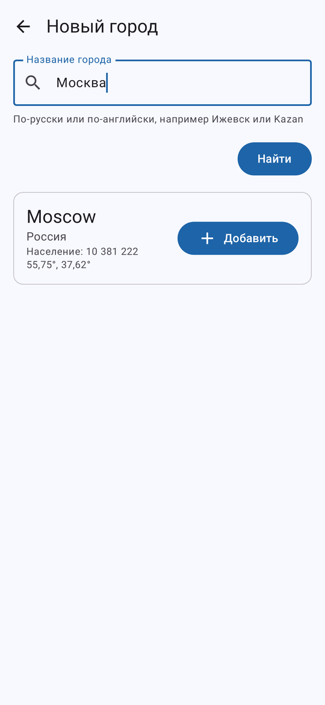
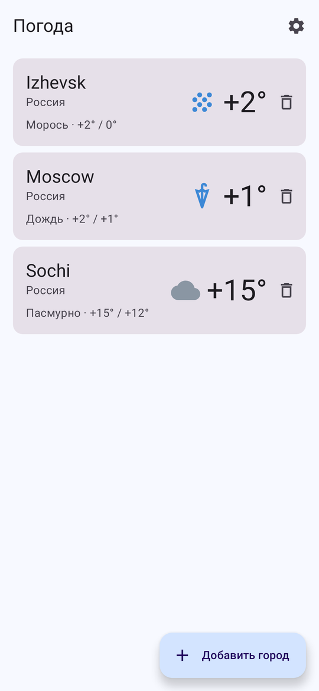
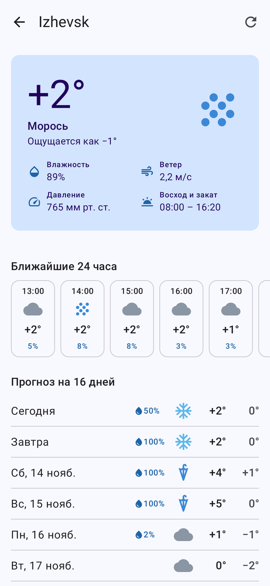
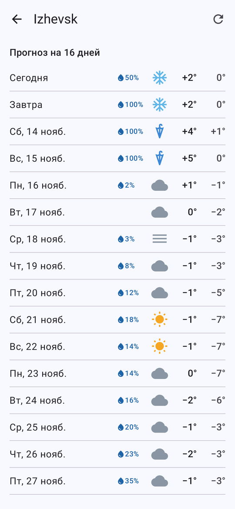
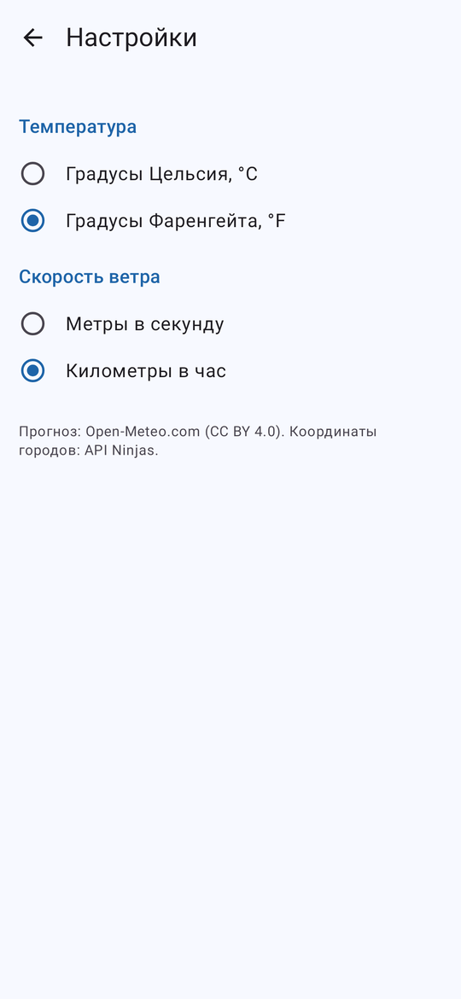
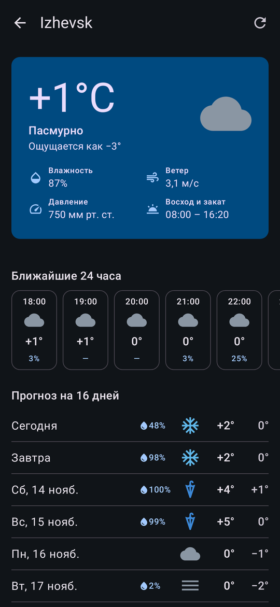

# Погода

Курсовая работа по дисциплине «Разработка мобильных приложений»: прогноз погоды для списка городов, который пользователь составляет сам. Интерфейс на Jetpack Compose.

Источники данных:
- [Open-Meteo](https://open-meteo.com/en/docs) — прогноз по координатам: текущая погода, 24 часа и 16 дней. Ключ не нужен.
- [API Ninjas](https://api-ninjas.com) — координаты города по названию: [City](https://api-ninjas.com/api/city) и, если там города нет, [Geocoding](https://api-ninjas.com/api/geocoding). Нужен бесплатный ключ.

## Как запустить

1. Зарегистрироваться на [api-ninjas.com](https://api-ninjas.com) и скопировать ключ из личного кабинета.
2. Добавить строку в файл `local.properties` в корне проекта (файл не попадает в git):
   ```
   API_NINJAS_KEY=ваш_ключ
   ```
3. Открыть проект в Android Studio и запустить конфигурацию `app` (minSdk 26).

Ключ подключает [secrets-gradle-plugin](https://developers.google.com/maps/documentation/android-sdk/secrets-gradle-plugin): в коде он доступен как `BuildConfig.API_NINJAS_KEY`, в репозитории лежит только заглушка `local.defaults.properties`. Без ключа приложение собирается и показывает погоду для уже добавленных городов, а экран поиска объясняет, чего не хватает.

## Что умеет

- Список выбранных городов с текущей температурой, значком погоды и минимумом/максимумом на сегодня. Обновление — жестом вниз, удаление — с кнопкой «Отменить».
- Поиск города по-русски или по-английски. Сначала кириллица переводится в латиницу («Ижевск» → Izhevsk) и ищется в API Ninjas City. Если английское название с транслитом не совпадает (Москва — Moscow, а не Moskva), запрос уходит в геокодинг API Ninjas, который понимает название так, как его набрали.
- Экран города: сейчас (ощущаемая температура, влажность, ветер, давление, восход и закат), лента на 24 часа и прогноз на 16 дней с вероятностью осадков.
- Настройки единиц: °C или °F, ветер в м/с или км/ч. Хранятся в Preferences DataStore, прогноз перезагружается сразу.
- Русский и английский интерфейс, тёмная тема. В русском интерфейсе давление в мм рт. ст., в английском — в гПа.

## Как устроено

| Слой | Пакет | Что внутри |
|---|---|---|
| Данные | `data` | Retrofit + kotlinx.serialization (`OpenMeteoService`, `CityService`, модели ответов), Room (`SavedCityEntity`, `CityDao`, `WeatherDatabase`), DataStore (`DataStoreSettingsRepository`), мапперы и репозитории `DefaultCityRepository`, `DefaultWeatherRepository`, контейнер зависимостей `DefaultAppContainer` |
| Домен | `domain` | модели (`City`, `Forecast`, `WeatherCondition` с кодами WMO и др.), интерфейсы `CityRepository`, `WeatherRepository`, `SettingsRepository`, транслитерация названий |
| Интерфейс | `ui` | экраны Compose, ViewModel со `StateFlow` для каждого экрана, фабрика `AppViewModelProvider`, навигация Navigation Compose с типобезопасными маршрутами |

Тесты (`gradlew testDebugUnitTest`): разбор настоящего ответа Open-Meteo на MockWebServer, запросы к API Ninjas на настоящих ответах (ключ в заголовке, транслитерация, переход на геокодинг, ошибка ключа), ViewModel всех экранов на подменных репозиториях.

## Экраны

| Поиск города | Список городов | Прогноз | 16 дней |
|---|---|---|---|
|  |  |  |  |

| Настройки | Тёмная тема |
|---|---|
|  |  |
